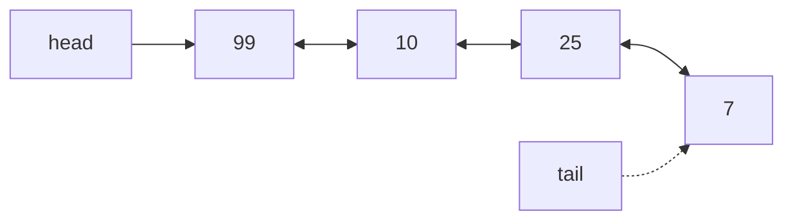
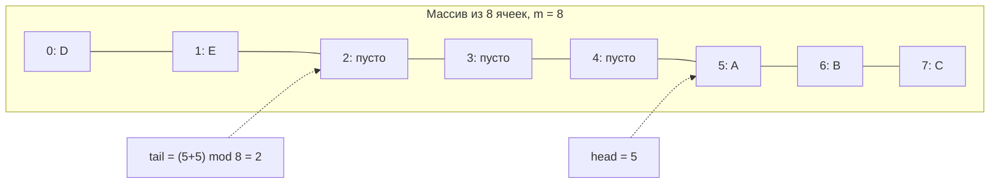
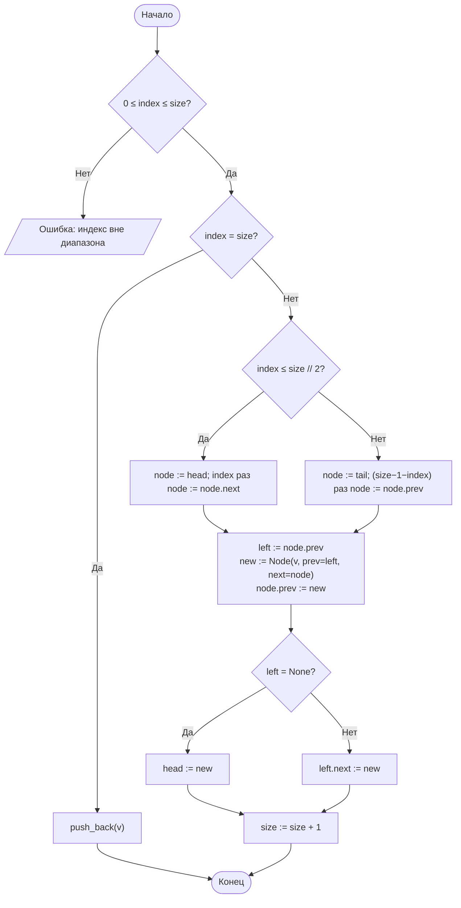

# Лабораторная работа № 6. Реализация линейных структур данных и анализ трудоёмкости их операций

**Дисциплина:** Теория алгоритмов  
**Направление подготовки:** 38.03.05 «Бизнес-информатика»  
**Выполнила:** Кугушева Арина, группа БИ2-1  
**Вариант:** 13

| Файл | Назначение |
|---|---|
| `README.md` | описание работы, разбор кода для защиты, результаты и выводы (этот файл) |
| `lab6_variant13.py` | программа с подробными комментариями: структуры, плей-лист, эксперименты, самотесты |
| `report_lab6_variant13.pdf` | отчёт с титульным листом, схемами, листингом, таблицами и графиками |
---

## 1. Цель работы и задание варианта

**Цель работы:** изучить линейные структуры данных, реализовать их на основе массива и связанных узлов и экспериментально установить, как выбор структуры определяет трудоёмкость типовых операций.

| Параметр | Значение |
|---|---|
| Реализуемые структуры | двусвязный список, очередь на кольцевом буфере |
| Исследуемые операции | вставка в середину, обход в обе стороны |
| Размеры $n$ | 1000; 2000; 4000 |
| Прикладная задача | плей-лист с переходами |
| Дополнительные требования | Т1 — проверка на малом примере; Т2 — сравнение со встроенным `list`; Т3 — график $T(n)$ и оценка; Т4 — память на 10 000 элементов (`sys.getsizeof`) |

## 2. Описанные структуры и их операции

**Двусвязный список.** Каждый узел хранит значение и две ссылки: `prev` (на предыдущий) и `next` (на следующий). Список хранит `head`, `tail` и `size`. Если ссылка на узел уже есть, вставка рядом и удаление выполняются за $\Theta(1)$; чтобы добраться до $i$-го узла, нужен обход — $\Theta(n)$.

| Операция | Метод | Трудоёмкость |
|---|---|---|
| Вставка в начало / в конец | `push_front`, `push_back` | $\Theta(1)$ |
| Вставка рядом с известным узлом | `insert_after`, `insert_before` | $\Theta(1)$ |
| Вставка по номеру (в середину) | `insert(index, v)` | $\Theta(n)$ |
| Доступ по номеру | `get`, `node_at` | $\Theta(n)$ |
| Удаление узла по ссылке; из начала и из конца | `remove_node`, `pop_front`, `pop_back` | $\Theta(1)$ |
| Обход вперёд / назад | `walk_forward`, `walk_backward` | $\Theta(n)$ |
| Поиск значения | `find` | $\Theta(n)$ |

**Очередь на кольцевом буфере.** Массив ёмкости $m$, индекс головы `head` и счётчик `count`; позиция записи $\text{tail}=(\text{head}+\text{count}) \bmod m$. `enqueue` и `dequeue` — $\Theta(1)$, элементы не сдвигаются.

**Плей-лист (прикладная задача).** Двусвязный список треков, указатель на текущий трек и очередь «играть следующим» на кольцевом буфере. Переход «следующий»/«предыдущий» — один шаг по ссылке ($\Theta(1)$), после последнего трека идёт первый и наоборот (по кругу); трек после текущего добавляется за $\Theta(1)$; вставка на номер — $\Theta(n)$.

## 3. Схема структур данных



Вставка `insert(2, 55)` меняет четыре ссылки: `new.prev = 10`, `new.next = 25`, `10.next = new`, `25.prev = new` (рисунок в PDF, рис. 1а).



### Блок-схема вставки по номеру `insert(index, v)`



## 4. Разбор программы (для защиты)

| Часть | Что в ней | Главная мысль |
|---|---|---|
| 1. Константы | `SIZES`, `MIDDLE_OPS`, `REPEATS`, `SEED` | параметры эксперимента собраны в одном месте |
| 2. `Node`, `DoublyLinkedList` | узел с `prev`/`next`; методы вставки, удаления, обхода | вставка рядом с известным узлом — $\Theta(1)$, поиск позиции — $\Theta(n)$ |
| 3. `CircularQueue` | массив, `head`, `count`, `enqueue`, `dequeue` | tail вычисляется как `(head + count) % capacity`; сдвигов нет |
| 4. `Playlist` | список треков, `current`, очередь `up_next` | переход = одна ссылка; по кругу — проверка на `None` |
| 5. Измерения | `timed(setup, action)` | объект строится вне замера; берётся медиана 7 запусков |
| 6. Эксперименты | вставка в середину, обход, плей-лист, очередь, память | каждый эксперимент — отдельная функция |
| 7. Т1 и самотесты | `demo_small`, `check_correctness` | случайные операции сверяются с `list` и `deque`; проверка целостности ссылок `check_links` |
| 8. Вывод | `print_report`, `save_plots`, `main` | параметры `--plots` и `--json` |

**Вставка по номеру (`insert`).** Сначала проверяется диапазон. Если `index == size` — это вставка в конец (`push_back`). Иначе `node_at(index)` находит узел, стоящий на этой позиции (идём от головы, если индекс в первой половине, иначе от хвоста), и `insert_before` ставит новый узел перед ним. В `insert_before` порядок строгий: сначала создаётся новый узел с обеими ссылками, затем переключаются ссылки соседей, иначе потеряется один из них. Если слева соседа нет — новый узел становится головой.

**Почему `node_at` стоит Θ(n), хотя идём с ближнего конца.** Для середины всё равно $n/2$ шагов; выигрыш только вдвое, порядок роста не меняется. Эксперимент: время растёт вдвое при удвоении $n$.

**Удаление `remove_node`.** Левый и правый соседи «перешагивают» через узел: `left.next = right`, `right.prev = left`; если соседа нет, обновляется `head` или `tail`.

**Кольцевая очередь.** Индекс записи вычисляется, а не хранится. После `enqueue` пяти элементов в буфер ёмкости 5 и трёх `dequeue` голова стоит в ячейке 3; следующие две записи идут в ячейки 0 и 1 — запись «перешла» через конец массива. Это видно в выводе программы (раздел Т1).

**Плей-лист.** `next_track` берёт `current.next`; если он `None` — переходит на `head`. `prev_track` зеркально. `add_after_current` вызывает `insert_after(current, …)` без поиска, поэтому $\Theta(1)$, а `insert_at(pos, …)` вызывает `insert` и стоит $\Theta(n)$.

**Что показать на защите:** `python lab6_variant13.py` (малый пример Т1, самотесты и все таблицы, ≈ 10 секунд); `python lab6_variant13.py --plots plots` (графики).

## 5. Листинг программы

Полный текст — в файле [`lab6_variant13.py`](lab6_variant13.py) и в PDF-отчёте.

```bash
python lab6_variant13.py                       # демонстрация и все измерения
python lab6_variant13.py --plots plots         # + графики (нужен matplotlib)
python lab6_variant13.py --json results.json   # + результаты в JSON
```

## 6. Результаты

Среда: Linux, Python 3.13.18. Время — медиана из 7 запусков. Вставка в середину: 200 вставок в структуру из $n$ элементов на позицию $n/2$. Обход — полный проход по $n$ элементам. Плей-лист — 10 000 переходов.

**Таблица 1. Т2. Вставка в середину ($200$ вставок), с**

| $n$ | Двусвязный список: по номеру | Двусвязный список: после известного узла | `list.insert` |
|---|---|---|---|
| 1000 | 0,00165 | 0,00005 | 0,00002 |
| 2000 | 0,00351 | 0,00005 | 0,00004 |
| 4000 | 0,00708 | 0,00005 | 0,00007 |

**Таблица 2. Т2. Полный обход в обе стороны, с**

| $n$ | Список: вперёд | Список: назад | `list`: вперёд | `list`: назад (`reversed`) |
|---|---|---|---|---|
| 1000 | 0,00003 | 0,00003 | 0,00001 | 0,00001 |
| 2000 | 0,00005 | 0,00005 | 0,00001 | 0,00001 |
| 4000 | 0,00011 | 0,00011 | 0,00002 | 0,00003 |

**Таблица 3. Плей-лист: 10 000 переходов, с**

| $n$ | «Следующий» | «Предыдущий» |
|---|---|---|
| 1000 | 0,00055 | 0,00052 |
| 2000 | 0,00054 | 0,00053 |
| 4000 | 0,00055 | 0,00054 |

**Таблица 4. Очередь: $n$ постановок и $n$ извлечений, с**

| $n$ | Кольцевой буфер | `list.pop(0)` |
|---|---|---|
| 1000 | 0,00025 | 0,00010 |
| 2000 | 0,00051 | 0,00021 |
| 4000 | 0,00104 | 0,00064 |

**Таблица 5. Т4. Память на 10 000 элементов, байт**

| Структура | `sys.getsizeof` | Фактический прирост (`tracemalloc`) |
|---|---|---|
| Двусвязный список (56 Б на узел × 10 000) | 560 000 | 560 368 |
| Встроенный `list` | 80 056 | 85 120 |
| Кольцевой буфер | 80 056 | 80 136 |

`sys.getsizeof` для списка Python учитывает только массив указателей, поэтому для двусвязного списка считается размер всех узлов. Сами числа одинаковы во всех структурах и в сравнение не входят.

**Таблица 6. Т3. Сопоставление с теорией: отношения $T(2n)/T(n)$ (для $n=1000\to2000$ / $2000\to4000$)**

| Операция | Структура | Теория | Эксперимент | Соответствие |
|---|---|---|---|---|
| Вставка в середину по номеру | двусвязный список | $\Theta(n)$ (ждём ≈ 2) | 2,1 / 2,0 | Да |
| Вставка после известного узла | двусвязный список | $\Theta(1)$ (≈ 1) | 1,0 / 1,0 | Да |
| Вставка в середину | `list` | $\Theta(n)$ (≈ 2) | 1,6 / 1,8 | Да |
| Обход вперёд | двусвязный список | $\Theta(n)$ (≈ 2) | 1,9 / 2,1 | Да |
| Обход назад | двусвязный список | $\Theta(n)$ (≈ 2) | 2,1 / 2,0 | Да |
| Переход в плей-листе | двусвязный список | $\Theta(1)$ (≈ 1) | 1,0 / 1,0 | Да |
| $n$ постановок + $n$ извлечений | кольцевой буфер | $\Theta(n)$ (≈ 2) | 2,0 / 2,0 | Да |
| $n$ постановок + $n$ извлечений | `list.pop(0)` | $\Theta(n^2)$ (→ 4) | 2,1 / 3,1 | Да |

`list.insert` и `list.pop(0)` дают меньшие отношения, чем чистая теория (1,6–1,8 вместо 2; около 2–3 вместо 4): при таких малых $n$ время сдвига в C-коде мал по сравнению с накладными расходами цикла Python, и квадратичный рост проявляется постепенно.

Графики (вставка в середину, обход, переходы в плей-листе) — в PDF-отчёте (рис. 2–4).

## 7. Обоснование выбора структуры для задачи «Плей-лист с переходами»

| Требование плей-листа | Структура / операция | Трудоёмкость |
|---|---|---|
| Следующий и предыдущий трек | двусвязный список, `next_track`, `prev_track` | $\Theta(1)$ |
| Переход по кругу | проверка `None` и переход на `head`/`tail` | $\Theta(1)$ |
| Добавить трек после текущего | `insert_after(current, …)` | $\Theta(1)$ |
| Удалить текущий трек | `remove_node(current)` | $\Theta(1)$ |
| Вставить трек на позицию по номеру | `insert(pos, …)` | $\Theta(n)$ |
| Очередь «играть следующим» | кольцевой буфер | $\Theta(1)$ |

Односвязный список не позволяет перейти к предыдущему треку без прохода сначала ($\Theta(n)$), а массив требует сдвига при вставке и удалении рядом с текущим треком. Двусвязный список даёт все частые операции за $\Theta(1)$; его слабое место — вставка по номеру и доступ по номеру, которые для плей-листа нужны редко.

## 8. Выводы

1. Вставка в середину двусвязного списка по номеру имеет трудоёмкость Θ(n): время 200 вставок растёт в 2,1 / 2,0 раза при удвоении n (0,00165 с, 0,00351 с, 0,00708 с). Перестановка четырёх ссылок стоит Θ(1), но до середины нужно дойти — это n/2 шагов, и именно поиск позиции определяет время.
2. Если ссылка на узел уже есть (insert_after), вставка выполняется за Θ(1): время не зависит от n (0,00005 с при n = 1000 и 0,00005 с при n = 4000; отношения 1,0 / 1,0). При n = 4000 это в 131 раз быстрее вставки по номеру. Именно поэтому в плей-листе вставка после текущего трека дешёвая.
3. Встроенный list тоже тратит Θ(n) на вставку в середину (сдвиг хвоста массива), отношения 1,6 / 1,8, но делает это быстрым кодом на C: при n = 4000 он в 108 раз быстрее нашего списка вставкой по номеру. Асимптотика у структур одинакова, различается константа.
4. Обход в обе стороны стоит Θ(n) и для списка, и для массива; прямой и обратный обходы двусвязного списка занимают одинаковое время (при n = 4000: 0,00011 и 0,00011 с). Однако обход двусвязного списка в 5,4 раза медленнее обхода list: узлы разбросаны по памяти и требуют разыменования ссылок, а элементы массива лежат подряд (лучше работает кэш процессора).
5. Плей-лист: время 10 000 переходов «следующий/предыдущий» практически не зависит от размера плей-листа (0,00055, 0,00054 и 0,00055 с при n = 1000, 2000, 4000); переход — одно присваивание ссылки, Θ(1). Замыкание списка «по кругу» делается проверкой на None без дополнительных структур.
6. Кольцевая очередь выполняет постановку и извлечение за Θ(1): n постановок и n извлечений дают рост времени в 2,0 / 2,0 раза при удвоении n (линейный). Сдвигающая очередь на list.pop(0) растёт быстрее: 2,1 / 3,1 (стремится к квадратичному), но при n ≤ 4000 остаётся быстрее благодаря быстрому C-коду memmove. Преимущество кольца проявится при больших n; кроме того, у него нет сдвигов и память выделяется один раз.
7. Память на 10 000 элементов (Т4). Узел двусвязного списка занимает 56 Б (sys.getsizeof) — три поля плюс служебные данные объекта, поэтому 560 000 Б на узлы против 80 056 Б у массива указателей в list (7,0 раза больше). Замер tracemalloc подтверждает: 560 368 Б против 85 120 Б; кольцевой буфер (80 136 Б) не отличается от массива. Значения-числа во всех структурах одни и те же и в сравнение не включены.
8. Выбор структуры определяется преобладающими операциями: переходы по плей-листу и вставки рядом с текущим треком — двусвязный список; доступ по номеру и просмотр целиком — массив; очередь заявок — кольцевой буфер. Универсально лучшей структуры нет.

## 9. Ответы на контрольные вопросы

**1. Чем абстрактный тип данных отличается от его реализации? Пример АТД с двумя реализациями.**  
АТД задаёт набор операций и их смысл (что делать), реализация — способ хранения и алгоритмы операций (как). Пример: АТД «очередь» реализуется кольцевым буфером на массиве или цепочкой узлов; операции enqueue/dequeue одни и те же, а трудоёмкость и расход памяти разные.

**2. Сформулируйте LIFO и FIFO. По два примера.**  
LIFO (последним пришёл — первым вышел) — стек: отмена последнего действия, проверка скобок. FIFO (первым пришёл — первым вышел) — очередь: заявки в службу поддержки, очередь «играть следующим» в плей-листе.

**3. Почему доступ по индексу в массиве Θ(1), а в связном списке Θ(n)?**  
Элементы массива лежат подряд, адрес i-го вычисляется как base + i·size одним действием. Узлы списка разбросаны по памяти и связаны только ссылками, поэтому до i-го элемента нужно пройти i шагов. В опыте при n = 4000: вставка по номеру в середину 0,00708 с против 0,00005 с, когда узел уже известен.

**4. Что такое амортизированная сложность? Почему вставка в конец динамического массива O(1) амортизированно?**  
Это средняя стоимость операции по длинной серии операций (а не по случайным данным). Массив при заполнении удваивается и копируется за Θ(n), но такие копирования происходят при размерах 1, 2, 4, …, и суммарно n вставок стоят n + n/2 + n/4 + … < 3n, то есть O(1) на вставку.

**5. Зачем в связном списке хранят ссылку на хвост?**  
Чтобы вставка в конец была Θ(1): без tail пришлось бы пройти весь список (Θ(n)). В двусвязном списке tail к тому же даёт удаление последнего элемента за Θ(1) и обход в обратную сторону с конца.

**6. Преимущество двусвязного списка перед односвязным и его цена?**  
Плюсы: обход в обе стороны, удаление узла по ссылке за Θ(1) (знаем левого соседа), pop_back за Θ(1), выбор ближнего конца при поиске индекса. Цена: вторая ссылка в каждом узле (больше памяти), и вставка/удаление переставляют четыре ссылки вместо двух, что повышает риск ошибок. Узел в нашей реализации занимает 56 Б.

**7. Как устроен кольцевой буфер? Роль операции взятия остатка?**  
Массив фиксированной ёмкости m, индекс головы head и число элементов count; позиция записи tail = (head + count) mod m, шаг головы head = (head + 1) mod m. Остаток замыкает массив в кольцо: после ячейки m − 1 следует ячейка 0, поэтому элементы не нужно сдвигать, и обе операции Θ(1).

**8. Почему массив на практике часто быстрее связного списка?**  
Элементы массива лежат подряд: процессор подгружает их в кэш пачками, а встроенный list написан на C. Узлы списка разбросаны, каждый переход по ссылке может дать промах кэша, плюс память на ссылки. В опыте обход list быстрее обхода двусвязного списка в 5,4 раза, а вставка в середину при n = 4000 — в 108 раз, хотя асимптотика вставки у них одинакова.

**9. Как реализовать очередь двумя стеками? Амортизированная стоимость?**  
Входной стек принимает enqueue (push). При dequeue, если выходной стек пуст, все элементы переносятся из входного в выходной (порядок переворачивается), затем pop из выходного. Каждый элемент переносится не более одного раза, поэтому амортизированная стоимость каждой операции — O(1).

**10. Какую структуру выбрать для журнала последних 100 событий?**  
Кольцевой буфер ёмкостью 100: новое событие записывается по индексу (head + count) mod 100, а при заполнении затирает самое старое. Память фиксирована, запись Θ(1), копирования и сдвигов нет.

