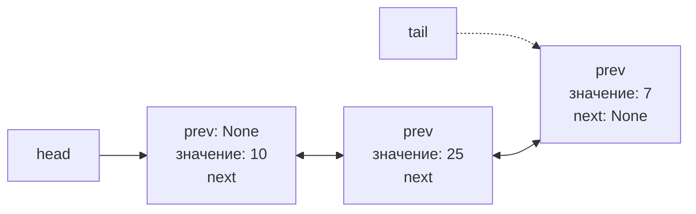
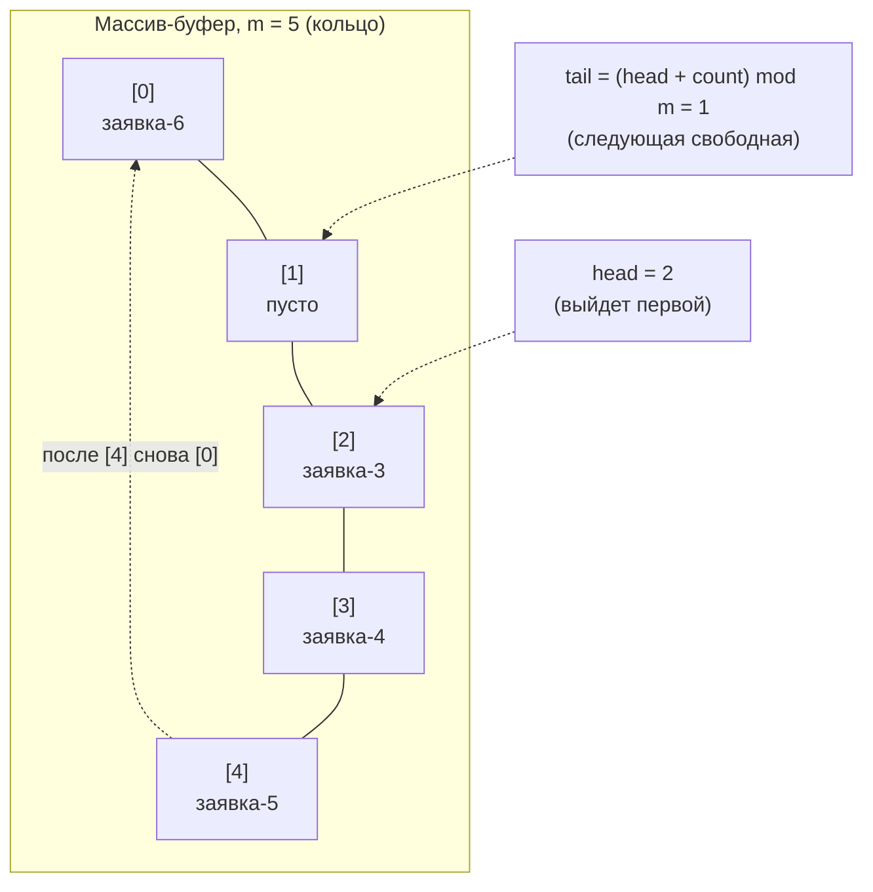
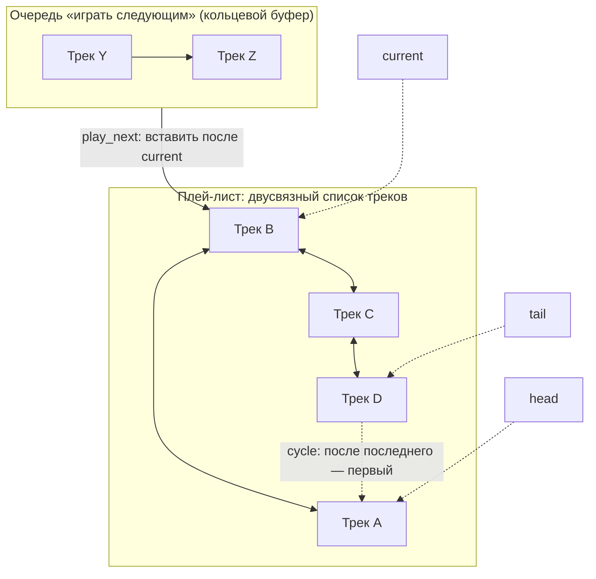
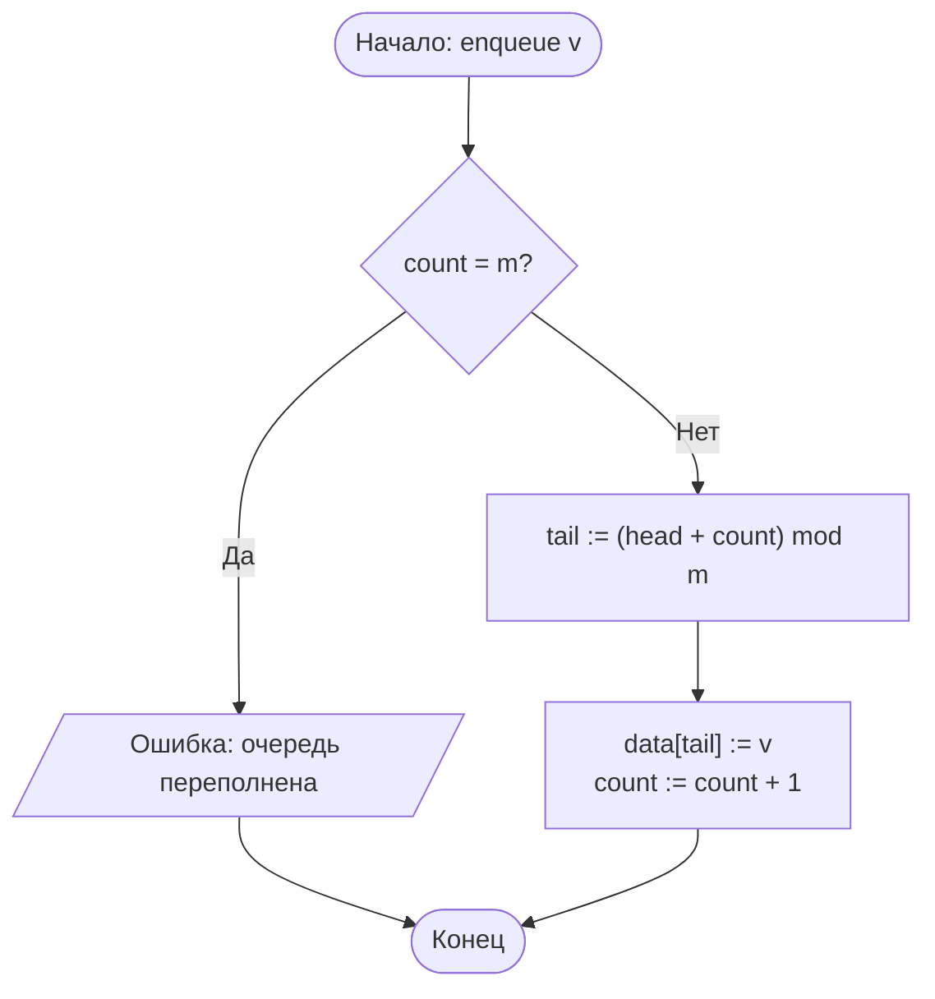
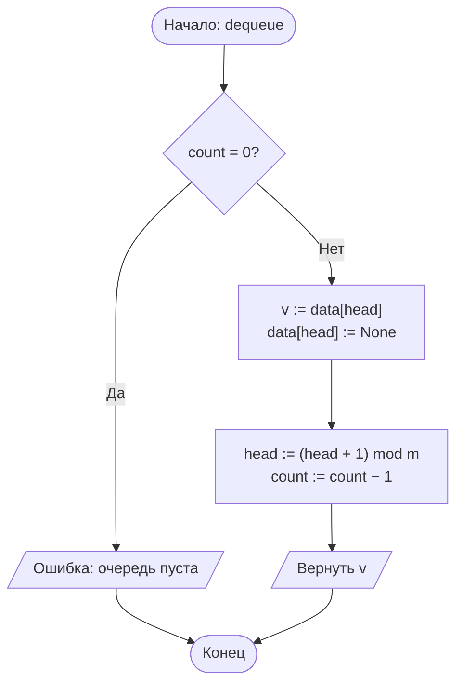
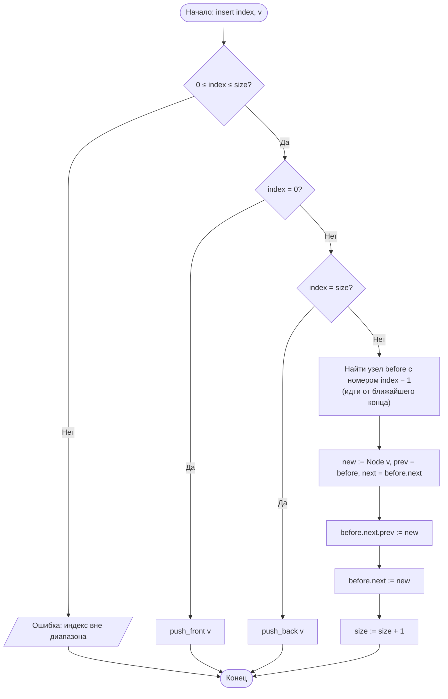
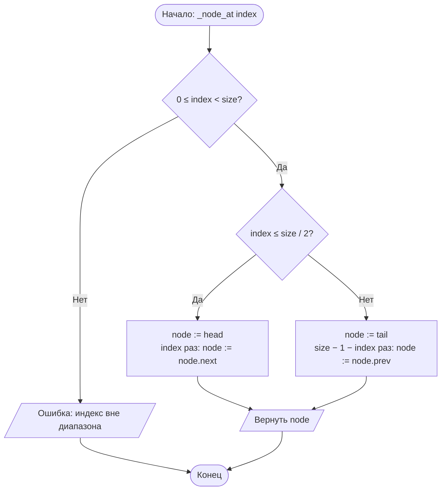

# Лабораторная работа № 6. Вариант 13

**Реализация линейных структур данных и анализ трудоёмкости их операций**

| | |
|---|---|
| **Дисциплина** | Теория алгоритмов |
| **Направление** | 38.03.05 «Бизнес-информатика» |
| **Выполнила** | Кугушева Арина Вячеславовна, группа БИ 2-1 |
| **Вариант** | 13 |

## Файлы

| Файл | Назначение |
|---|---|
| `lr6_variant13.py` | программа: алгоритмы, генерация данных, самопроверка, эксперименты, графики |
| `otchet_lr6_variant13.pdf` | отчёт по требованиям задания |
| `README.md` | этот файл |

## Запуск

```bash
pip install matplotlib
python lr6_variant13.py
```

Полный прогон занимает около 5–10 секунд; программа печатает характеристики системы и таблицы результатов и сохраняет графики `lr6_plot.png` и `lr6_plot_memory.png`. Параметр `--json FILE` сохраняет результаты в JSON, `--show` показывает графики на экране.


## 1. Цель работы и задание варианта

**Цель работы:** изучить линейные структуры данных (связный список, очередь на кольцевом буфере), реализовать их и экспериментально установить, как выбор структуры определяет трудоёмкость типовых операций.

**Задание (вариант 13).** Реализовать **двусвязный список** и **кольцевую очередь**. Измерить время **вставки в середину** и **обхода в обе стороны** для собственной реализации и для встроенного `list` при n = 1000, 2000, 4000. Решить прикладную задачу «**плей-лист с переходами**».

| № | Структуры | Исследуемые операции | Размеры n | Прикладная задача |
|---|---|---|---|---|
| 13 | Двусвязный список, кольцевая очередь | Вставка в середину, обход в обе стороны | 1000; 2000; 4000 | Плей-лист с переходами |

**Дополнительные требования** (для всех вариантов): Т1 — проверка на малом примере с выводом содержимого после каждой операции; Т2 — измерение времени каждой операции для своей реализации и для `list`; Т3 — графики T(n) и определение соответствия оценкам Θ(1)/Θ(n); Т4 — оценка расхода памяти на 10 000 элементов с помощью `sys.getsizeof`.

**Условия эксперимента.** Время измерялось функцией `time.perf_counter()`; результат — медиана по 7 повторам после одного прогревочного запуска, на время замера сборщик мусора отключался. Подготовка данных (построение структуры) во время замера не входит. Вставка в середину: время одной операции по серии из 100 вставок в позицию len/2 (для list — по серии из 1000; для вставки после известного узла — из 1000). Обход: суммарное время прохода по всем n элементам. Доступ по индексу: среднее время одного из 200 обращений к случайным позициям. Кроме времени подсчитывается число **переходов по ссылкам** («шагов») — машинно-независимая мера, которую можно сопоставлять с теорией напрямую.

Дополнительно (помимо варианта) для наглядности исследованы: вставка после уже известного узла, обход назад «без ссылок prev» (через доступ по индексу от головы), доступ по индексу, очередь в сравнении с `collections.deque` и `list.pop(0)`, расход памяти (Т4).


## 2. Описание реализованных структур и их операций

**Двусвязный список** (класс `DoublyLinkedList`). Каждый узел `Node` хранит значение и две ссылки — `prev` и `next`; список хранит ссылки на голову `head` и хвост `tail`. Реализованы операции: `push_front`, `push_back`, `insert(i, v)`, `insert_after(node, v)`, `pop_front`, `pop_back`, `delete(i)`, `remove_node(node)`, `get(i)`, `find(v)`, обход вперёд (`for x in list`) и назад (`reversed()`).

Вставка и удаление сводятся к переустановке ссылок и стоят Θ(1), **если узел известен**. Доступ к i-му элементу требует прохода по ссылкам: благодаря двум ссылкам проход начинается с ближайшего конца, поэтому число переходов равно min(i, n − 1 − i), то есть до n/2 (в среднем n/4 при случайном i). Вставка в *середину по индексу* — Θ(n): ≈ n/2 переходов до позиции плюс Θ(1) на перестановку четырёх ссылок. Наличие ссылки `prev` даёт удаление из конца за Θ(1) и обход назад за Θ(n); в односвязном списке обход назад потребовал бы Θ(n²) переходов (доступ к каждому элементу с головы: 0 + 1 + … + (n − 1) = n(n − 1)/2 — это измерено в эксперименте).

**Кольцевая очередь** (класс `CircularQueue`) — FIFO на массиве фиксированной ёмкости m. Хранятся индекс головы `head` и число элементов `count`; позиция записи tail = (head + count) mod m, поэтому после последней ячейки запись продолжается с нулевой. `enqueue` и `dequeue` выполняются за Θ(1) без сдвига элементов; при переполнении и извлечении из пустой очереди выбрасываются исключения. В обычном массиве извлечение из начала (`list.pop(0)`) требует Θ(n) на сдвиг.

**Плей-лист** (класс `Playlist`): треки лежат в двусвязном списке, текущий трек — ссылка `current` на узел. Реализованы переходы `next_track`/`prev_track` (с зацикливанием), вставка трека после текущего, удаление текущего, очередь «играть следующим» на кольцевом буфере (`queue_next`, `play_next`).

**Таблица 1. Теоретическая трудоёмкость операций**

| Операция | Двусвязный список | Кольцевая очередь | Массив (list) |
|---|---|---|---|
| Доступ по индексу | Θ(n) (до n/2 переходов) | — | Θ(1) |
| Вставка в начало / конец | Θ(1) | enqueue: Θ(1) | Θ(n) / O(1) аморт. |
| Вставка в середину по индексу | Θ(n) (поиск позиции) | — | Θ(n) (сдвиг) |
| Вставка после известного узла | Θ(1) | — | — |
| Удаление из начала / конца | Θ(1) / Θ(1) | dequeue: Θ(1) | Θ(n) / Θ(1) |
| Обход вперёд / назад | Θ(n) / Θ(n) | — | Θ(n) / Θ(n) |
| Поиск значения | Θ(n) | Θ(n) | Θ(n) |
| Память на элемент | данные + 2 ссылки + заголовок узла | данные + ячейка | данные + ссылка |


## 3. Схемы структур данных и блок-схемы алгоритмов



*Рис. 1. Схема двусвязного списка (узлы и ссылки prev / next)*



*Рис. 2. Схема кольцевого буфера (m = 5): tail вычисляется по модулю m, поэтому запись переходит через конец массива*



*Рис. 3. Схема плей-листа: двусвязный список треков, указатель current, зацикливание и очередь «играть следующим»*



*Рис. 4. Блок-схема постановки в кольцевую очередь (enqueue)*



*Рис. 5. Блок-схема извлечения из кольцевой очереди (dequeue)*



*Рис. 6. Блок-схема вставки в двусвязный список по индексу (insert)*



*Рис. 7. Блок-схема поиска узла по индексу с ближайшего конца (_node_at)*


## 4. Листинг программы

Файл `lr6_variant13.py` (самодостаточный модуль с подробными комментариями: структуры, плей-лист, самопроверка, малый пример, измерения, память, графики). Запуск: `python lr6_variant13.py`; требуется matplotlib.

Полный текст программы — в файле [`lr6_variant13.py`](lr6_variant13.py).


## 5. Характеристики вычислительной системы

| Параметр | Значение |
|---|---|
| Процессор | Intel(R) Xeon(R) Processor @ 2.10GHz, 2 логических ядра |
| Оперативная память | 8 ГБ |
| Операционная система | Linux (Ubuntu 24.04) |
| Интерпретатор | Python 3.13.18 |
| Таймер | time.perf_counter() |

*Абсолютные значения времени зависят от системы; число переходов по ссылкам, показатели роста и соотношения между структурами должны сохраниться. Программа при запуске выводит характеристики системы автоматически.*


## 6. Результаты

6.1. Проверка на малом примере (Т1)

Содержимое структур выводится после каждой операции (для списка — в обе стороны, для очереди — также состояние буфера). Результаты соответствуют ожидаемым.

```text
--- Т1. Малый пример: двусвязный список ---
push_back 10..80             вперёд: [10, 20, 30, 40, 50, 60, 70, 80]  назад: [80, 70, 60, 50, 40, 30, 20, 10]  длина: 8
push_front(5)                вперёд: [5, 10, 20, 30, 40, 50, 60, 70, 80]  назад: [80, 70, 60, 50, 40, 30, 20, 10, 5]  длина: 9
insert(4, 99) - середина     вперёд: [5, 10, 20, 30, 99, 40, 50, 60, 70, 80]  назад: [80, 70, 60, 50, 40, 99, 30, 20, 10, 5]  длина: 10
insert(1, 11)                вперёд: [5, 11, 10, 20, 30, 99, 40, 50, 60, 70, 80]  назад: [80, 70, 60, 50, 40, 99, 30, 20, 10, 11, 5]  длина: 11
insert_after(узла 99, 77)    вперёд: [5, 11, 10, 20, 30, 99, 77, 40, 50, 60, 70, 80]  назад: [80, 70, 60, 50, 40, 77, 99, 30, 20, 10, 11, 5]  длина: 12
get(4) / find(77)            30 / 6
pop_front()                  вперёд: [11, 10, 20, 30, 99, 77, 40, 50, 60, 70, 80]  назад: [80, 70, 60, 50, 40, 77, 99, 30, 20, 10, 11]  длина: 11
pop_back()                   вперёд: [11, 10, 20, 30, 99, 77, 40, 50, 60, 70]  назад: [70, 60, 50, 40, 77, 99, 30, 20, 10, 11]  длина: 10
delete(3)                    вперёд: [11, 10, 20, 99, 77, 40, 50, 60, 70]  назад: [70, 60, 50, 40, 77, 99, 20, 10, 11]  длина: 9

--- Т1. Малый пример: кольцевая очередь (ёмкость 5) ---
enqueue(заявка-1)      очередь: ['заявка-1']  head=0  count=1  буфер: ['заявка-1', None, None, None, None]
enqueue(заявка-2)      очередь: ['заявка-1', 'заявка-2']  head=0  count=2  буфер: ['заявка-1', 'заявка-2', None, None, None]
enqueue(заявка-3)      очередь: ['заявка-1', 'заявка-2', 'заявка-3']  head=0  count=3  буфер: ['заявка-1', 'заявка-2', 'заявка-3', None, None]
enqueue(заявка-4)      очередь: ['заявка-1', 'заявка-2', 'заявка-3', 'заявка-4']  head=0  count=4  буфер: ['заявка-1', 'заявка-2', 'заявка-3', 'заявка-4', None]
dequeue()              -> заявка-1
после dequeue          очередь: ['заявка-2', 'заявка-3', 'заявка-4']  head=1  count=3  буфер: [None, 'заявка-2', 'заявка-3', 'заявка-4', None]
dequeue()              -> заявка-2
после dequeue          очередь: ['заявка-3', 'заявка-4']  head=2  count=2  буфер: [None, None, 'заявка-3', 'заявка-4', None]
enqueue(заявка-5)      очередь: ['заявка-3', 'заявка-4', 'заявка-5']  head=2  count=3  буфер: [None, None, 'заявка-3', 'заявка-4', 'заявка-5']
enqueue(заявка-6)      очередь: ['заявка-3', 'заявка-4', 'заявка-5', 'заявка-6']  head=2  count=4  буфер: ['заявка-6', None, 'заявка-3', 'заявка-4', 'заявка-5']
enqueue(заявка-7)      очередь: ['заявка-3', 'заявка-4', 'заявка-5', 'заявка-6', 'заявка-7']  head=2  count=5  буфер: ['заявка-6', 'заявка-7', 'заявка-3', 'заявка-4', 'заявка-5']
enqueue(заявка-8)      -> Очередь переполнена
```

6.2. Прикладная задача: плей-лист (сценарий)

Знаком ► отмечен текущий трек. Видно: переходы вперёд и назад, вставка после текущего, очередь «играть следующим», удаление текущего и зацикливание на границах.

```text
--- Прикладная задача: плей-лист с переходами ---
начальное состояние                ►Трек A | Трек B | Трек C | Трек D | Трек E
next_track()                       Трек A | ►Трек B | Трек C | Трек D | Трек E  -> играет: Трек B
next_track()                       Трек A | Трек B | ►Трек C | Трек D | Трек E  -> играет: Трек C
prev_track()                       Трек A | ►Трек B | Трек C | Трек D | Трек E  -> играет: Трек B
add_after_current('Трек X')        Трек A | ►Трек B | Трек X | Трек C | Трек D | Трек E
queue_next('Трек Y'), Z            очередь: ['Трек Y', 'Трек Z']
play_next() (из очереди)           Трек A | Трек B | ►Трек Y | Трек X | Трек C | Трек D | Трек E  -> играет: Трек Y
play_next() (из очереди)           Трек A | Трек B | Трек Y | ►Трек Z | Трек X | Трек C | Трек D | Трек E  -> играет: Трек Z
play_next()                        Трек A | Трек B | Трек Y | Трек Z | ►Трек X | Трек C | Трек D | Трек E  -> играет: Трек X
remove_current()                   Трек A | Трек B | Трек Y | Трек Z | ►Трек C | Трек D | Трек E  -> играет: Трек C
3 x next_track() - конец           ►Трек A | Трек B | Трек Y | Трек Z | Трек C | Трек D | Трек E  -> играет: Трек A
next_track() - к началу (цикл)     Трек A | ►Трек B | Трек Y | Трек Z | Трек C | Трек D | Трек E  -> играет: Трек B
prev_track() - к концу (цикл)      ►Трек A | Трек B | Трек Y | Трек Z | Трек C | Трек D | Трек E  -> играет: Трек A
```

6.3. Измерения времени операций (Т2)

**Таблица 2. Вставка в середину: время одной операции, мкс**

| n | Двусвязный список: insert(i, v) | Переходов по ссылкам на операцию | Двусвязный список: insert_after(узел) | list.insert(i, v) |
|---|---|---|---|---|
| 1 000 | 8,76 | 524 | 0,17 | 0,22 |
| 2 000 | 17,56 | 1024 | 0,34 | 0,27 |
| 4 000 | 35,39 | 2024 | 0,18 | 0,46 |

Для проверки роста `list.insert` в середину (время одной операции, мкс) на больших n: n = 10 000: 0,9; n = 100 000: 10,7; n = 1 000 000: 159,9.

**Таблица 3. Обход всех n элементов, мс**

| n | DLL вперёд (next) | DLL назад (prev) | Назад «по индексам от головы» | Переходов в этом случае | list вперёд | list назад |
|---|---|---|---|---|---|---|
| 1 000 | 0,049 | 0,048 | 7,99 | 499 500 | 0,024 | 0,025 |
| 2 000 | 0,084 | 0,080 | 34,56 | 1 999 000 | 0,040 | 0,040 |
| 4 000 | 0,152 | 0,148 | 134,54 | 7 998 000 | 0,064 | 0,070 |

**Таблица 4. Доступ по индексу: время одного обращения, мкс**

| n | DLL: get(i) | Переходов в среднем | list[i] |
|---|---|---|---|
| 1 000 | 3,77 | 249,8 | 0,070 |
| 2 000 | 7,85 | 500,9 | 0,064 |
| 4 000 | 17,68 | 1019,5 | 0,074 |

**Таблица 5. Очередь: n постановок и n извлечений (суммарное время), мс**

| n | Кольцевая очередь | collections.deque | list.append + list.pop(0) |
|---|---|---|---|
| 1 000 | 0,31 | 0,08 | 0,09 |
| 2 000 | 0,59 | 0,13 | 0,23 |
| 4 000 | 1,21 | 0,26 | 0,68 |
| 16 000 | 4,71 | 0,91 | 20,94 |
| 64 000 | 18,98 | 3,42 | 361,52 |


*Рис. 8. Графики T(n): вставка в середину, обход, доступ по индексу, очередь (для очереди — логарифмические шкалы)*

6.4. Расход памяти (Т4)

**Таблица 6. Память на 10 000 элементов (int = 28 Б, узел Node = 56 Б)**

| Структура | sys.getsizeof (глубокий подсчёт), Б | Б на элемент | tracemalloc, Б | Б на элемент |
|---|---|---|---|---|
| list | 360 056 | 36,0 | 391 832 | 39,2 |
| Двусвязный список | 840 048 | 84,0 | 871 912 | 87,2 |
| Кольцевая очередь (ёмкость 10 000) | 360 104 | 36,0 | 391 912 | 39,2 |

sys.getsizeof не учитывает вложенные объекты, поэтому размеры контейнера, всех узлов и всех объектов int суммировались вручную; значение tracemalloc приведено для проверки.


*Рис. 9. Расход памяти на 10 000 элементов*


## 7. Сводная таблица «операция — структура — теоретическая оценка — эксперимент»

T(2n)/T(n) — отношения времени при удвоении n (n = 1000→2000 и 2000→4000); k — показатель в T ~ n<sup>k</sup> по трём точкам. Для Θ(1) ожидается отношение ≈ 1, для Θ(n) — ≈ 2, для Θ(n²) — ≈ 4.

| Операция | Структура | Теория | T(2n)/T(n) | k | Соответствие |
|---|---|---|---|---|---|
| Вставка в середину по индексу | Двусвязный список | Θ(n) | 2,01; 2,02 | 1,01 | Да; число переходов 524 / 1024 / 2024 ≈ n/2 |
| Вставка после известного узла | Двусвязный список | Θ(1) | 2,00; 0,51 | 0,02 | Да: роста нет (0 переходов), время ≈ 0,2–0,35 мкс — на уровне шума |
| Вставка в середину | list | Θ(n) | 1,25; 1,67 | 0,53 | Да, но при n ≤ 4000 доминирует фиксированная стоимость вызова; на n = 10⁴…10⁶ рост линейный |
| Обход вперёд | Двусвязный список | Θ(n) | 1,70; 1,82 | 0,81 | Да (≈ линейно; малое n — фиксированные издержки) |
| Обход назад | Двусвязный список (prev) | Θ(n) | 1,66; 1,86 | 0,82 | Да (≈ линейно) |
| Обход назад без ссылок prev | Доступ по индексу от головы | Θ(n²) | 4,33; 3,89 | 2,04 | Да: ≈ 4, переходов n(n − 1)/2 |
| Обход вперёд | list | Θ(n) | 1,68; 1,59 | 0,71 | Да |
| Доступ по индексу | Двусвязный список | Θ(n) | 2,08; 2,25 | 1,11 | Да; в среднем 250 / 501 / 1020 переходов ≈ n/4 |
| Доступ по индексу | list | Θ(1) | 0,92; 1,16 | 0,05 | Да: время не зависит от n |
| n постановок + n извлечений | Кольцевая очередь | Θ(n) всего, Θ(1) на операцию | 1,92; 2,05 | 0,99 | Да; при 16 000 → 64 000 отношение 4,0 (ожидалось 4) |
| n постановок + n извлечений | list: append + pop(0) | Θ(n²) всего | — | — | Да: при 16 000 → 64 000 время выросло в 17,3 раз (ожидалось 16) |

Для очень быстрых операций (доли микросекунды) и малых n измерение содержит фиксированную составляющую (вызов функции, создание списка-аккумулятора), поэтому показатели k у них смещены; надёжным подтверждением служат число переходов по ссылкам и измерения на больших n.


## 8. Обоснование выбора структуры для задачи «плей-лист с переходами»

Основные действия пользователя: переход к следующему и предыдущему треку, вставка трека сразу после текущего («играть следующим»), удаление текущего трека, зацикливание на границах плей-листа. Все они выполняются **относительно текущей позиции**, то есть узел известен заранее.

| Требование | Двусвязный список | Односвязный список | Массив (list) |
|---|---|---|---|
| Переход вперёд | Θ(1) по next | Θ(1) | Θ(1) (индекс + 1) |
| Переход назад | **Θ(1) по prev** | Θ(n) — проход с головы | Θ(1) |
| Вставка после текущего | **Θ(1)**: 4 ссылки | Θ(1) | Θ(n): сдвиг хвоста |
| Удаление текущего | **Θ(1)** | Θ(n): нужен предыдущий узел | Θ(n): сдвиг |
| Доступ к треку по номеру | Θ(n) (до n/2) | Θ(n) | Θ(1) |

**Выбор.** Двусвязный список — единственная из рассмотренных структур, у которой *все* действия вокруг текущего трека стоят Θ(1): переход назад обеспечивает ссылка prev (в односвязном списке он стоил бы Θ(n), а полный обход назад — Θ(n²), что подтверждено измерением: 135 мс против 0,15 мс при n = 4000), а вставка и удаление сводятся к перестановке ссылок без сдвига. Зацикливание реализуется переходом от хвоста к голове (и наоборот) за Θ(1). Очередь «играть следующим» естественно строится на кольцевом буфере: постановка и извлечение за Θ(1), ёмкость ограничена (в плеере это несколько ближайших треков).

**Оговорка.** Двусвязный список проигрывает при доступе к треку по номеру (Θ(n): 1020 переходов в среднем при n = 4000, 17,68 мкс против 0,07 мкс у list) и расходует больше памяти (2,3 раза). Для небольших плей-листов (сотни-тысячи треков) выигрыш на практике незаметен: встроенный list.insert в середину на n = 4000 занимает 0,46 мкс благодаря быстрому копированию памяти в C. Преимущество списка проявляется при частом редактировании больших списков, при хранении ссылки на текущий узел и там, где важна гарантированная трудоёмкость Θ(1) независимо от размера. Если бы требовался частый «прыжок» на трек по номеру, лучше был бы массив.


## 9. Выводы

1. **Теория подтверждена.** Вставка в середину двусвязного списка по индексу — Θ(n): время растёт при удвоении n в 2,01 и 2,02 раза (8,76 → 17,56 → 35,39 мкс), а число переходов по ссылкам равно 524, 1024, 2024 (≈ n/2 — поиск позиции с ближайшего конца). Вставка после *известного* узла от n не зависит (Θ(1)): 0 переходов, ≈ 0,2–0,35 мкс — примерно на два порядка быстрее вставки по индексу при n = 4000.

2. **Главное преимущество связного списка — не вставка «по номеру», а вставка и удаление в известной позиции.** Если позиция задана индексом, список не лучше массива: дойти до неё стоит Θ(n). Встроенный `list.insert` тоже линеен (при n = 10⁴, 10⁵, 10⁶: 0,9, 10,7, 160 мкс), но на малых n он быстрее списка из-за маленькой константы (сдвиг памяти в C): при n = 4000 0,46 мкс против 35,39 мкс у списка.

3. **Обход в обе стороны — Θ(n) и симметричен.** Обход вперёд по `next` и назад по `prev` занимают одинаковое время (при n = 4000: 0,152 и 0,148 мс), рост при удвоении n ≈ 1,70–1,82. Без ссылки prev обход назад через доступ по индексу от головы стоит Θ(n²): 7 998 000 переходов и 135 мс при n = 4000 (в 906 раз медленнее), отношение времён при удвоении n равно 4,33 и 3,89 (теория 4). Это главное оправдание второй ссылки.

4. **Доступ по индексу** у двусвязного списка — Θ(n) (в среднем 250, 501, 1020 переходов ≈ n/4 благодаря выбору ближайшего конца), у массива — Θ(1) (0,07 мкс при любом n против 17,68 мкс у списка при n = 4000). Если требуется частый доступ по номеру, выбирается массив.

5. **Кольцевая очередь** выполняет постановку и извлечение за Θ(1): суммарное время n + n операций растёт линейно (отношения 1,92 и 2,05), память не выделяется заново, элементы не сдвигаются. Очередь на `list` с `pop(0)` квадратична: при n = 64 000 она в 19 раз медленнее кольцевой (361,52 против 18,98 мс), хотя при n = 1000–4000 разница мала или обратная. Реализация на чистом Python при этом уступает C-реализации `collections.deque` в 5,6 раза при n = 64 000 — учебная реализация нужна для понимания устройства, в практике используется deque.

6. **Память (Т4).** На 10 000 элементов list занимает 360 056 Б (36 Б на элемент: 8 Б ссылка + 28 Б объект int), двусвязный список — 840 048 Б (84 Б на элемент), то есть в 2,3 раза больше: каждый узел — отдельный объект (56 Б: заголовок объекта и три ссылки — значение, prev, next) вместо одной ячейки в массиве. Кольцевая очередь расходует столько же, сколько list (36 Б на элемент), так как это массив фиксированной ёмкости. Данные tracemalloc отличаются от getsizeof менее чем на 10 %. Кроме того, узлы размещены в памяти произвольно, что ухудшает использование кэша процессора: обход списка медленнее обхода массива в 2,4 раза при n = 4000 несмотря на одинаковую асимптотику.

7. **Плей-лист.** Для задачи с переходами вперёд и назад, вставкой после текущего трека и удалением текущего оптимален двусвязный список (все операции Θ(1) относительно текущего узла) в сочетании с кольцевой очередью для списка «играть следующим». Правильность реализации проверена самопроверкой на случайных операциях в сравнении с `list` и `deque` и сценарием, приведённым в разделе 6.2.


## 10. Список литературы

1. Кормен Т., Лейзерсон Ч., Ривест Р., Штайн К. Алгоритмы: построение и анализ. — 3-е изд. — М.: Вильямс, 2013. — Гл. 10.

2. Кнут Д. Э. Искусство программирования. Т. 1. Основные алгоритмы. — 3-е изд. — М.: Вильямс, 2018. — Гл. 2.2.

3. Седжвик Р., Уэйн К. Алгоритмы на Java. — 4-е изд. — М.: Вильямс, 2013. — Гл. 1.3.

4. Документация Python: collections.deque; time complexity [Электронный ресурс]. — URL: https://wiki.python.org/moin/TimeComplexity

